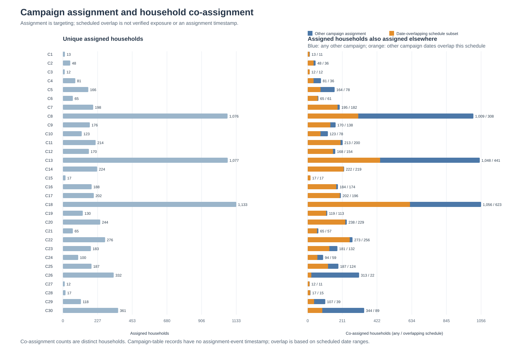
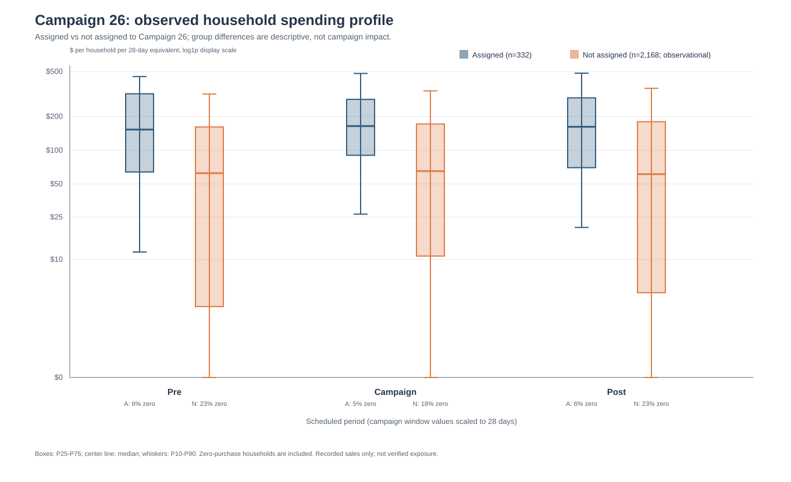

# Promo Effectiveness

Retail Media teams need to distinguish sales observed around a campaign from sales the campaign actually caused. Assignment, coupon redemption and promotion records can describe targeting and activity, but without verified exposure and a credible counterfactual they do not establish incrementality.

The measurement workflow is relevant to Retail Media teams such as Endeavour Group's. The analysis uses a public sample dataset, not any retailer's campaign data. This completed analytical case study validates campaign and promotion data, assesses an observational design, and reports campaign spending descriptively. The observational data did not support a defensible causal uplift estimate. The project therefore proposes a prospective randomised holdout for future incrementality measurement.

**Explore the work:** [Executive brief](docs/promo_effectiveness_executive_brief.md) · [Full case study](docs/promo_effectiveness_case_study.md) · [Proposed experiment](docs/experiment_design.md) · [Validated notebook](notebooks/01_promo_effectiveness.ipynb)

## Key findings

| Evidence | Result | Interpretation |
|---|---:|---|
| Campaign coverage | 30 campaigns assessed | Campaign assignment and scheduled overlap were summarised across the sample. |
| Recorded coupon use | 2,318 redemption events | Events are recorded coupon use, not verified media exposure. |
| Promotion-record coverage | 21.72% of transaction lines matched | The other 78.28% have unknown promotion status; they cannot be labelled unpromoted. |
| Campaign 26 | 332 assigned households; 31 unique redeemers | Assignment, unique redeemers and redemption events are distinct measures. |
| Matching feasibility | 277 unique pairs; measured covariates balanced | Absolute SMDs were below 0.10 for 14 measured covariates, but an independent historical-spending-trend diagnostic failed (slope SMD −1.053). |
| Causal conclusion | No uplift estimate | Unknown assignment timing, missing verified exposure and the historical trend imbalance prevent a defensible observational causal claim. |

### Campaign assignment and co-assignment



*Counts distinguish households assigned to other campaigns from those whose other campaign schedule overlapped. Scheduled overlap does not establish shared household exposure.*

### Campaign 26 observed spending



*Household spending is shown per 28-day equivalent, with zero-purchase households included. These observed distributions are descriptive, not campaign impact.*

## Proposed incrementality experiment

The proposed test evaluates one fixed Retail Media package in a prospective holdout. Randomise eligible households 1:1 when the campaign can be suppressed across the relevant channels; use store or geographic clusters only when household-level suppression is not feasible and enough independent clusters are available. Analyse by intention to treat, retaining every unit in its assigned arm regardless of delivery or redemption.

The primary outcome is total retailer sales per eligible household during a **42-day campaign**, with a **28-day follow-up** for secondary purchasing measures. Assignment, delivery, redemption and sales must be logged separately. No experiment has been conducted.

An illustrative **10% minimum detectable effect (MDE) requires 5,156 total households** under the documented assumptions: equal household allocation, two-sided α = 0.05, 80% power and a single-window cross-household SD of 247.47 sample-dataset sales units. This planning scenario excludes cluster inflation, audience loss and delivery dilution. Repeated historical observations of the same households are not counted as independent units.

## Technical approach and reproducibility

The analysis is implemented in Python and queries the existing PostgreSQL `retail_analytics` database and `dbt_dev` reporting models using read-only transactions. Larger sales and promotion tables are aggregated in SQL before results are returned to Python.

- `config.py` loads local credentials securely and creates read-only SQLAlchemy connections.
- `extract.py` queries existing dbt campaign, assignment, redemption, sales and promotion models.
- `validation.py` checks inclusive campaign windows, duration normalisation, unique assignments and schedule overlap.
- `descriptive.py` calculates campaign, redemption, household-spending and promotion-coverage summaries.
- `charts.py` generates the two SVG figures; `power.py` implements sample-size, MDE and household-window variability calculations.

The **12 committed standalone tests** cover campaign-window boundaries, overlap counts, zero-purchase handling, redemption events versus unique redeemers, promotion coverage and power calculations. Run them independently of PostgreSQL:

```powershell
$Python = '<path-to-existing-retail-dbt>\Scripts\python.exe'
& $Python -m pip install -r requirements-analysis.txt
& $Python -m unittest tests.test_experiment_design tests.test_promo_effectiveness -v
```

Reproducing the notebook and database-backed power input has an additional prerequisite: access to the existing PostgreSQL environment with populated `dbt_dev` models and local credentials in the ignored `secrets/retail-analytics.env`. This repository does not create a database or container, ingest raw data, or rebuild dbt models. See the [reproduction guide](docs/promo_effectiveness_reproduction.md). The project extends the shared infrastructure maintained in [Retail Performance Analytics](https://github.com/siddharthaananthula/retail-performance-analytics); it does not claim a separate raw-to-report pipeline.

## Data source and publication notes

The analysis uses dunnhumby's [*The Complete Journey* sample dataset](https://www.dunnhumby.com/source-files/). The source page describes classroom and academic research uses but does not specify a dataset license for derived outputs. This project attributes the source and publishes aggregate analysis under the portfolio's documented publication approach; it does not claim explicit dataset-specific permission. Raw and processed row-level data, credentials, database files and embedded Power BI reports are excluded. See [data-source notes](docs/data_source.md) and the [publication manifest](docs/publication_manifest.md).

The analysis code has no separate licence declaration. Dataset terms and code licensing are separate matters.
