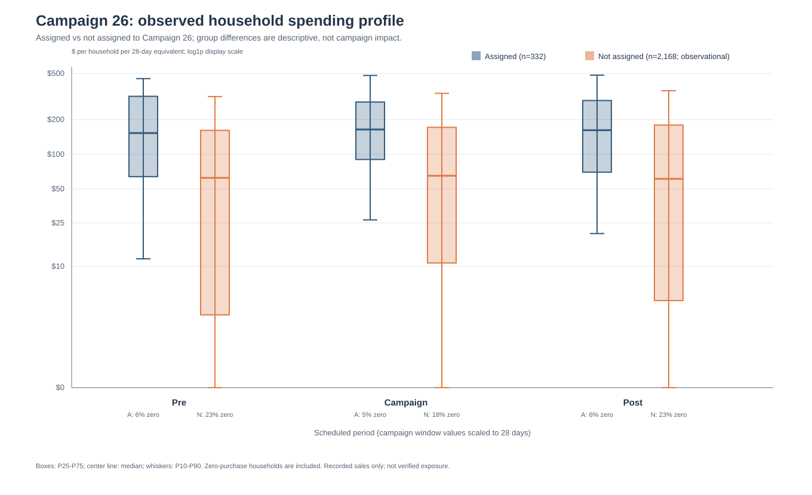
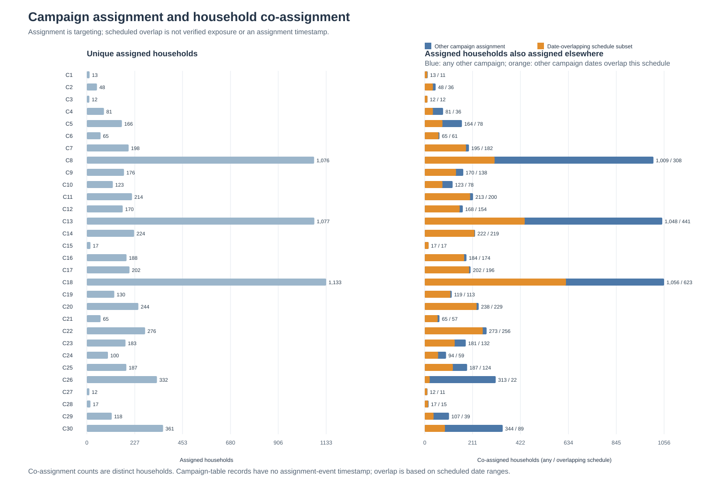

# Promo Effectiveness: from attribution to a credible experiment

**Portfolio case study** · **Descriptive analysis complete** · **Randomised experiment proposed, not run**

**Decision:** Do not claim incremental campaign impact from the existing observational data. Use it to describe targeting, recorded redemptions, sales patterns and data quality; require a prospective randomised holdout before making an incrementality claim.

This is a Promo Effectiveness portfolio extension using the PostgreSQL and dbt foundation from Retail Performance Analytics. It analyses dunnhumby's *The Complete Journey* public sample dataset, obtained separately and modelled in the shared database. Figures come from the public sample dataset, not a retailer's campaign data; permission to publish dataset-derived results remains unconfirmed.

For the concise leadership version, see the [one-page executive brief](promo_effectiveness_executive_brief.md). The prospective protocol is in the [experiment design](experiment_design.md); reproducible commands are in the [reproduction guide](promo_effectiveness_reproduction.md).

## Business problem and Retail Media relevance

Retailers and suppliers need to know whether retail media and promotions create additional retailer sales, rather than simply receive credit for sales that would have happened anyway. Targeting records, coupon use and promotional sales are useful operational signals, but none alone establishes a counterfactual.

This case study demonstrates a measurement workflow for a Retail Media team: validate campaign and transaction data, show what the available sources support, reject unsupported causal claims, then specify a feasible holdout design.

## Data sources and what they measure

The project reuses the existing local PostgreSQL database and `dbt_dev` reporting models. The principal sources are transaction lines, products, household demographics, campaign descriptions, household campaign targeting, coupon eligibility, coupon redemptions and product-store-week promotion records.

The checked sample contains **2,595,732 transaction lines**, **276,484 baskets**, **2,500 purchasing households**, **711 relative transaction days** and **30 campaigns**. Days are relative source values, not calendar dates; store IDs have no verified names or locations. Demographics cover 801 of 2,500 households (32.04%), so they cannot represent the full purchasing population.

The data describe different stages and must remain separate:

| Measure | What is observed | What it does not prove |
|---|---|---|
| Campaign assignment | Household was listed in the campaign targeting bridge. | Notification time, successful delivery, attention or exposure. |
| Coupon redemption | A coupon use was recorded for a household, coupon, campaign and day. | Whether the household saw a media placement or the campaign caused the purchase. |
| Promotion record | A product-store-week source record matched a transaction line. | A complete promotion history or customer-level exposure. |
| Transaction sales | Recorded sales value and baskets for observed households and relative days. | Margin, profit, media attribution or incremental sales. |

See [data source and reproduction](data_source.md) for provenance and the dataset-terms caveat. Aggregate results are published under the project's stated attribution practice; raw data and PBIX files are not included.

## Campaign and coupon validation

The campaign dimension contains 30 unique campaign IDs. The household-campaign bridge has 7,208 targeting rows; the campaign description duplicated in those rows had no mismatches against the campaign dimension. The bridge preserves its many-to-many grain so joining it directly to sales cannot multiply transaction lines. Campaign/assignment uniqueness and date rules are covered by the existing dbt tests.

Across the 30 campaigns, scheduled durations range from 33 to 162 relative days, with 12 to 1,133 unique assigned households per campaign. Campaign 26 is used here because it was already investigated in the project; this is not a claim that it was a campaign winner.

The source has **2,318 recorded redemption events** across 30 campaigns, from **434 unique households** and **556 distinct coupons**; exact duplicate redemption rows were not found. Validation found **zero redemption-to-campaign-assignment mismatches**. A redemption remains a recorded coupon-use event, not an exposure count.

The coupon-product-campaign mapping source also contains **5,164 exact duplicate rows** across 1,824 repeated key combinations (up to 19 copies of a combination). The existing staging model keeps one mapping per key without changing the raw source. This mapping deduplication is separate from the redemption-event check.

Campaign 26 has **332 assigned households**, **31 recorded redeemers** and **73 redemption events**.

Promotion records required a safe aggregation before joining to transaction sales. The source has 36,786,524 product-store-week state rows and 36,771,279 distinct product-store-week keys. There are 15,245 repeated keys with conflicting source states; the existing dbt model retains conflict evidence at a unique key rather than arbitrarily selecting one state. Of 2,595,732 sales lines, **563,774 match a promotion record (21.72%)** and **2,031,958 (78.28%) do not**. Unmatched means **promotion status unknown**, not “not promoted.” A further 858 matched sales lines carry a conflict flag. Promotion code meanings are not verified.

## Why the observational causal design was rejected

An initial 28-day pre/post coverage screen found 25 of 30 campaigns with enough observed transaction days for descriptive windows. Campaign 26 was explored as a matching candidate. The design audit reported **277 unique matched pairs**, 98.2% overlap-free treated retention and absolute post-match SMDs below 0.10 for the 14 reported measured covariates.

Those balance statistics were not sufficient for a causal claim. An independent historical spending-trend diagnostic remained materially imbalanced (slope SMD **−1.053**). The data do not contain a verified assignment or notification timestamp, so campaign start cannot be treated as assignment time. Excluding households based on other campaigns scheduled during or after the evaluation window can also select on post-assignment information. Household exposure is absent, promotion coverage is incomplete, and recorded coupon redemption is not a substitute for delivery telemetry.

The matching experiment was therefore stopped before treatment-effect estimation. There is no uplift or difference-in-differences result in this project. This is a deliberate analytical decision: good balance on observed levels does not repair uncertain timing, unmeasured selection or divergent historical trends.

## Campaign 26: descriptive spending profile

Campaign 26 is TypeA and runs on relative transaction days **224–264 inclusive** (41 days). The notebook uses days 196–223 for the 28-day pre-period and days 265–292 for the 28-day post-period. Each period includes all 2,500 purchasing households: **332 assigned** and **2,168 not assigned**. The non-assigned group is observational and may include assignment to other campaigns.

Amounts below are mean and median recorded household sales per 28-day equivalent. The 41-day campaign-period totals are scaled by `28/41`; this is a descriptive rate normalisation, not an estimated effect. Zero-purchase households remain in the denominator.

Amounts use the source dataset's sales-value unit; no retailer currency conversion has been performed.

| Window | Days | Assigned n | Assigned mean / median | Assigned active | Assigned zero | Not assigned n | Not assigned mean / median | Not assigned active | Not assigned zero |
|---|---:|---:|---:|---:|---:|---:|---:|---:|---:|
| Pre | 28 | 332 | 208.32 / 153.06 | 94.3% | 19 | 2,168 | 117.32 / 62.52 | 76.5% | 509 |
| Campaign | 41 (normalised to 28) | 332 | 221.14 / 164.50 | 95.2% | 16 | 2,168 | 123.81 / 65.19 | 82.3% | 383 |
| Post | 28 | 332 | 216.63 / 162.19 | 93.7% | 21 | 2,168 | 128.00 / 61.25 | 76.8% | 502 |

Mean baskets per household per 28-day equivalent were 7.15, 7.19 and 6.97 for assigned households across pre/campaign/post, compared with 4.28, 4.27 and 4.27 for the not-assigned group. This gap also exists before the campaign.

For context, the assigned group's mean over the full 41-day campaign window is 323.81 per household, compared with 181.29 for the not-assigned group. The normalised figures above are the appropriate duration comparison. The assigned group already has higher mean and median spending in the pre-period, and 94.3% (313/332) of assigned households have some other campaign assignment somewhere in the bridge. Twenty-two (6.6%) are co-assigned to a campaign whose scheduled dates overlap Campaign 26's own 41 days; the broader 28-day pre/during/post audit found 50 with another assignment in that evaluation window. These are assignment/schedule facts, not confirmed overlapping delivery.

The chart makes the descriptive distribution visible.

The campaign overview chart distinguishes assignment and schedule co-assignment across all 30 campaigns. Schedule overlap and household co-assignment are different measurements.

## Proposed randomised holdout

The next evidence step is a prospective test of one fixed supplier-funded, retailer-addressable media package. If delivery can be suppressed across all targeted channels at a stable household key, randomise eligible, consented, linkable households 1:1 before the first delivery. Treatment receives the defined package; holdout receives business-as-usual with that package suppressed. If shared store or geographic placement cannot be suppressed by household, randomise enough non-overlapping clusters and power and analyse at the cluster level.

The primary estimand is the intention-to-treat difference in **total retailer sales per eligible household** over a pre-registered 42-day campaign window. Keep all assigned units in their original arm, including delivery failures, crossovers, non-redeemers and zero-purchase households. Log eligibility, random assignment and timestamps separately from delivery/impressions, redemption and sales. Follow purchasing for 28 days after the campaign. Secondary measures include promoted-product sales, other-product spending, basket activity and repeat purchasing. Exposure logs are implementation telemetry; missing delivery records mean unknown delivery, not no exposure.

Before launch, confirm audience eligibility and size, household suppression, consent, transaction linkage, assignment/delivery telemetry, competing-campaign policy and stock/price data. Do not remove households based on campaign-period or later assignment. The full design, analysis plan, success rules and unresolved owner decisions are in [experiment_design.md](experiment_design.md).

## Sample size and power considerations

For illustration only, the power script reads three 42-day windows (days 98–139, 140–181, 182–223) from the existing sales mart. Each window has the same 2,500 households; the cross-household SDs are 227.04, 247.19 and 247.47 dataset sales units. The largest single-window SD, **247.47**, is used for planning. The pooled 7,500-row SD of 240.75 is retained as a descriptive spread only: the same households recur and period means differ, so it is not a single-window planning variance or 7,500 independent households. Assignment timing is unknown, so none of these windows is verified pre-assignment.

Using that largest single-window SD and an illustrative 42-day reference mean of 193.12, equal 1:1 household allocation, two-sided α=0.05 and 80% power gives:

| Relative MDE scenario | Approximate total households |
|---:|---:|
| 5% | 20,622 |
| 10% | 5,156 |
| 15% | 2,292 |

If there were only 2,500 eligible households, the normal-approximation MDE would be about 27.73 dataset sales units per household (14.4% of the reference mean). Counts exclude cluster inflation, data-linkage loss, non-compliance dilution and any gain from pre-period covariate adjustment. Use the retailer's eligible-population data and a design-specific simulation before approving a test. The reproducible calculation is in `scripts/experiment_power_scenarios.py` and `src/promo_effectiveness/power.py`.

## Business implications and next steps

The current data support a transparent description of who was assigned, who redeemed a coupon, what recorded sales looked like and where promotion metadata is missing or conflicting. They do not support attributing sales to campaign exposure, demonstrating supplier ROI or reporting incremental profit.

For a Retail Media leader, the practical recommendation is to make exposure and assignment auditable and reserve a measurable holdout before launch. For a Head of Data Science, the recommendation is to pre-register an ITT metric and run power on the real eligible audience with the actual randomisation unit. Finance must supply product contribution margin, retailer-funded discounts, media delivery/agency costs and supplier-funding terms to determine break-even economics; sales alone are not profit.

## Key terms

- **Standardised mean difference (SMD):** The difference between two groups' means divided by their pooled standard deviation. An absolute SMD below 0.10 is a common diagnostic for close balance on a measured feature; it does not show that groups are equivalent on unmeasured factors or free of bias.
- **Historical spending-trend diagnostic:** For the full-assignment matched cohort, the independent 12-week historical comparison used household-level slopes of weekly `log1p` sales from days 56–139, outside the matching feature window. The slope SMD of **−1.053** means the treated group's mean historical slope was 1.053 pooled standard deviations lower than the comparison group's. This is evidence of pre-existing trend imbalance, not a campaign effect.
- **Campaign screening score:** The 10 points were assigned as follows: 0–2 for clean treated sample size (0 below 100, 1 for 100–199, 2 at 200 or more); 0–2 for maximum absolute clean-cohort SMD across pre-period sales, baskets and activity (0 above 0.20, 1 above 0.10 through 0.20, 2 at or below 0.10); 0–2 for joint local support (0 below 50%, 1 from 50% to below 70%, 2 at 70% or more); 0–2 for assignment retention after overlap exclusion using those same support tiers; 1 for complete 28-day pre/post coverage; and 1 when clean comparisons number at least 100 and are at least as numerous as clean treated households. The minimum feasibility gate separately required clean treated N ≥100, maximum absolute SMD ≤0.20, local support ≥50%, assignment retention ≥50%, at least 100 clean comparisons and at least as many comparisons as clean treated households, plus complete coverage. **No campaign passed this full gate.**
- **Joint 2D local support:** The two features were `log1p` pre-period sales and `log1p` pre-period basket frequency, standardised using the clean comparison group. A treated household counted as supported if its fifth-nearest clean comparison was within the 95th-percentile leave-one-out fifth-neighbour distance among comparisons. The percentage is the share of clean treated households meeting that joint-distance rule; Campaign 26's screening value was 88.7%.
- **Why Campaign 26 was explored:** It led the relative screening ranking with **8/10**, so it was used for a design-only matching feasibility check even though it did not pass the absolute minimum gate. That follow-up assessed sample retention and covariate balance; it did not estimate an effect or override the gate.
- **Intention to treat (ITT):** The effect of assignment to a treatment offer, analysed with every eligible unit kept in its assigned group regardless of delivery, redemption or purchase.
- **Minimum detectable effect (MDE):** The smallest effect a planned test is designed to detect at specified significance and power levels. The project's 10% example is a prospective planning scenario, not an observed result.

### Reproduction and publication boundary

Run the descriptive notebook and experiment power script only with access to the existing `retail-dbt` environment and `dbt_dev` models. See [reproduction instructions](promo_effectiveness_reproduction.md). `secrets/`, source rows, database files and PBIX files remain excluded from Git. The project publishes attributed aggregate outputs under the practical approach documented in [data source and attribution](data_source.md), which records the dataset-specific publication caveat.
